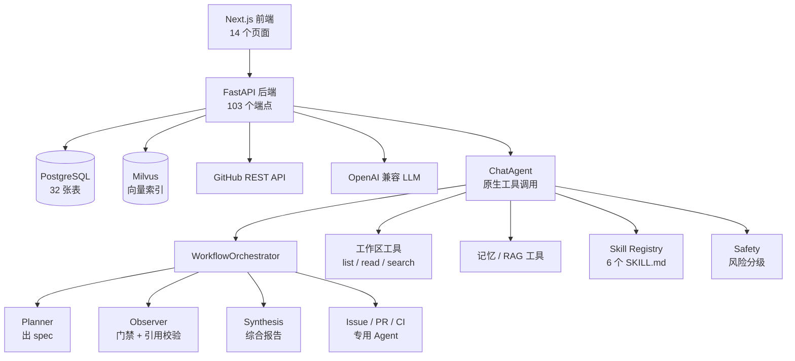

# Attest AI

> 把 Issue、PR diff、CI 日志和团队知识，变成一条条**能引用回原文**的工程判断。


---

## 这个项目解决什么问题

代码补全工具解决的是「这行怎么写」。但研发每天真正卡住的是另外三个问题：

- 这个 Issue 该谁接、多急、和哪个旧问题重复？
- 这个 PR 能不能合？风险在哪几个文件？
- 这条 CI 为什么挂，是代码问题还是环境问题？

回答这些问题需要把 Issue 描述、PR diff、Review 评论、CI 日志、项目文档和当前代码**拼在一起看**。人会做，但每次要花一到两小时；通用聊天模型也能总结，但它的结论无法追溯——你不知道它是读了日志还是猜的，所以不敢据此合并，更不敢让它直接往 GitHub 写东西。

Attest 做的是中间那层：**只读分析 → 带证据的结论 → 写操作只出草稿**。

## 它有什么不同

不是「又一个 RAG 聊天框」。以下六条都有对应代码和测试，不是设计口号。

**1. 结论必须能引用回原文。** 每个分析任务带一个 `WorkflowClaim`，声明它只允许读哪些数据源；Observer 检查结论时，模型的每条 finding 必须引用**两个不同事实**，且引用文本要能在原文里逐字校验。引用伪造、只有定位没有原文、证据数不足，都会被判为无效 finding。

**2. 规划归模型，调度归程序。** Planner 只输出 `WorkflowSpec`（任务、依赖、验收条件），由程序按依赖图并发执行、控制超时、决定是否重规划。模型不参与「先跑谁」的决策，避免不可复现的执行顺序。

**3. 降级是可见的，不装作用了模型。** 每个阶段记录 `llm` / `rules` / `rules_fallback` 三种来源。模型超时、输出不合 schema、没有 key，都会诚实标成 `rules_fallback` 并计入 `model_fallback_count`，不会把规则结果说成模型结论。

**4. 写操作止于草稿。** Agent 不能直接评论、建 Issue、关 Issue。所有外部写都落到 `ActionDraft`，先过风险策略（动作 × 目标范围 × 写入效果三维判定），再由人确认执行，执行结果与失败原因写回草稿并留审计。

**5. 上下文有预算，不是能塞多少塞多少。** 组装时按 system / memory / evidence / recent / tool 五段分配 token 配额；接近上限时四级渐进压缩，压缩时保留 `tool_use` 与 `tool_result` 的配对，不破坏协议结构。

**6. 评估能回归，不是跑一次看分数。** Ragas 五项指标各有阈值门禁；同一评测集 Hash 的两次结果可做对比；失败 Case 能一键生成 `create_issue` 草稿，把问题带回人工流程。

## 能做什么

| 能力 | 输入 | 输出 |
|---|---|---|
| Issue 分诊 | Issue 标题/正文/标签 + 相似历史 Issue + 代码 | 分类、优先级、复杂度、推荐负责人、重复候选、行动项 |
| PR 审查 | PR diff + 文件列表 + Review 评论 + CI 结论 | 摘要、关键变更、风险点、检查清单、测试建议、重点关注文件 |
| CI 排障 | Workflow Run + Job + 日志 + 近期 PR | 失败类型、可能原因、排查步骤、相关上下文 |
| 工程工作流 | 一句话目标（如「这个 PR 能合吗」） | 规划 → 多 Agent 并发 → 观察门禁 → 综合报告 + 引用 |
| 知识问答 | 上传文档 / 仓库文档 | 带编号引用的回答，证据不足时明确拒答 |
| 对话 Agent | 自然语言 | 原生工具调用，串联上述能力 + 工作区代码检索 |
| 周报 | 仓库近期活动 | 结构化工程周报 |
| 安全草稿 | 写操作意图 | 待确认草稿 + 风险等级 + 审计记录 |

## 架构



执行链路（一次工程工作流）：

```text
用户目标
  └─ Planner         规则规划 → 模型 proposal → 校验任务类型/依赖/循环 → 绑定 claim
      └─ Orchestrator 按依赖图分批并发，单任务超时兜底
          ├─ repo_health  → 仓库基线与数据完整度
          ├─ issue_analysis / pr_review / ci_debug / rag_search
          └─ 依赖失败的任务标 skipped，并记录 failed_dependencies
      └─ Observer     覆盖度 / 状态 / 证据 / 置信度 / 合并门禁 / 归属 / 安全 七类检查
          └─ 有可修复缺口 → 最多 2 轮重规划（只允许追加任务，已成功的任务不重跑）
      └─ Synthesis    输出决策 + 摘要 + finding + 引用，不授权任何外部写入
```

## 快速开始

前置：Docker、Python 3.11+、Node.js 18+。

**1. 起依赖**

```bash
cp .env.example .env      # 填入 LLM_API_KEY 与 GITHUB_TOKEN
docker compose up -d postgres etcd minio milvus
```

**2. 起后端**

```bash
cd backend
python -m venv .venv
.venv\Scripts\activate            # Windows；macOS/Linux: source .venv/bin/activate
pip install -r requirements.txt
uvicorn app.main:app --reload
```

**3. 起前端**

```bash
cd frontend
npm install
npm run dev
```

访问 `http://localhost:3000`，API 文档在 `http://localhost:8000/docs`。

**4. 确认链路**

```bash
curl http://localhost:8000/health
curl http://localhost:8000/api/ops/health/deep   # 逐组件状态：database / llm / milvus
```

### 只想先看页面？不装 Milvus

```powershell
.\scripts\start_rag.ps1
```

用 SQLite + deterministic embedding 起演示环境。它能验证页面、上传解析、关系库存储、混合检索的关键词分支和引用展示；向量检索状态会明确显示 `degraded`，**不能**用它证明完整 RAG 已跑通。

## 使用流程

```text
1. 接入仓库     /repos        填入 owner/name 与 token
2. 同步数据     POST /api/repos/{id}/sync    拉 Issue / PR / 文件 / Review / CI
3. 建知识库     /knowledge    上传文档或索引仓库文档，选 embedding 与检索参数
4. 提问         /chat         自然语言；Agent 自行决定调哪些工具
5. 跑工作流     /chat         说「这个 PR 能合吗」，触发多 Agent 闭环
6. 处理草稿     /action-drafts  确认或取消；确认后才真正写 GitHub
7. 看轨迹       /workflow-runs  任务级状态、依赖、错误、重规划次数
8. 做评估       /evals        跑 Ragas / OpenJudge，对比历史基线
```

## 配置

最小可用只需三项：

| 变量 | 说明 |
|---|---|
| `DATABASE_URL` | PostgreSQL 连接串 |
| `LLM_API_KEY` / `LLM_BASE_URL` / `LLM_MODEL` | 任意 OpenAI 兼容服务 |
| `GITHUB_TOKEN` | 只读即可跑分析；要执行草稿需 `repo` 写权限 |

影响行为的关键项：

| 变量 | 默认 | 作用 |
|---|---|---|
| `MILVUS_ENABLED` | `true` | 关闭后退化为关键词检索，状态显示 `degraded` |
| `EMBEDDING_PROVIDER` | `qwen_local` | `qwen_local` / `openai_compatible` / `deterministic` |
| `RAGAS_ENABLED` | `true` | 评测页是否启用语义指标 |
| `RAGAS_FAITHFULNESS_MIN` 等 | 见 `.env.example` | 五项指标门禁阈值 |
| `WORKFLOW_REPLAN_MODEL_ENABLED` | `false` | 重规划是否允许调模型补充 |
| `WORKFLOW_TASK_TIMEOUT_SECONDS` | `90` | 单任务超时 |
| `AUTO_SYNC_ENABLED` | `true` | 定时同步仓库 |
| `LOG_FORMAT` | `text` | 改 `json` 输出结构化日志 |

完整列表见 `.env.example`。

## 项目结构

```text
Attest/
├─ backend/app/
│  ├─ api/routes/         20 个路由模块，103 个端点
│  ├─ services/
│  │  ├─ agents/          Planner / Observer / Synthesis / ChatAgent / 专用 Agent
│  │  ├─ rag/             解析 → 切片 → embedding → 检索 → 重排 → 答案门禁
│  │  ├─ evals/           Ragas / OpenJudge / 评测集
│  │  ├─ github/          REST 客户端与同步
│  │  ├─ skills/          SKILL.md 注册与运行
│  │  ├─ chat_memory.py   上下文组装、证据库、渐进压缩
│  │  └─ safety_policy.py 三维风险策略表
│  ├─ core/               配置、日志、请求追踪、错误契约、加密
│  ├─ db/                 SQLAlchemy 模型（32 张表）
│  ├─ mcp/                MCP server（记忆检索）
│  └─ tests/              36 个测试文件
├─ frontend/app/          14 个页面（App Router）
├─ docs/                  架构、数据库、API、示例
└─ scripts/               评测调参、数据播种、本地演示启动
```

## 测试与评估

```bash
cd backend
python -m pytest app/tests -q          # 355 passed, 5 skipped，不需要外部服务
```

离线测试覆盖 Agent 契约、检索链路、上下文压缩、工作流策略、仓库同步、安全基线。需要真实模型的用例单独隔离，需显式开启：

```bash
ATTEST_RUN_LIVE_LLM=1 python -m pytest app/tests/test_workflow_live_models.py -v
```

**评估**在 `/evals` 页面或 API 上跑：

| 指标 | 衡量什么 |
|---|---|
| Context Precision / Recall | 检索到的证据是否准、是否全 |
| Faithfulness | 回答是否有证据支撑，不看答案好不好听 |
| Answer Relevancy | 回答是否切题 |
| Agent Goal Accuracy | 多步工具调用是否达成目标 |
| Tool Call Accuracy / F1 | 工具选得对不对、参数用没用对 |

评测会保存评测集 Hash、阈值、逐题工具轨迹与证据，同 Hash 两次结果可直接对比。

## API 一览（节选）

| 分组 | 端点 |
|---|---|
| 仓库 | `POST /api/repos/connect`、`POST /api/repos/{id}/sync`、`GET /api/repos/{id}/sync-status` |
| 对话 | `POST /api/chat`、`POST /api/chat/stream`、`POST /api/chat/plan`、`GET /api/chat/workflow-runs` |
| 分析 | `POST /api/issues/{id}/analyze`、`POST /api/pull-requests/{id}/analyze`、`POST /api/workflow-runs/{id}/analyze` |
| 知识库 | `POST /api/rag/knowledge-bases`、`POST /api/rag/{repo_id}/ask`、`POST /api/rag/{repo_id}/search` |
| 草稿 | `POST /api/action-drafts`、`POST /api/action-drafts/{id}/confirm`、`GET /api/action-drafts/audit-logs` |
| 评估 | `POST /api/evals/rag/run`、`GET /api/evals/compare`、`POST /api/evals/{id}/rescore` |
| 运维 | `GET /api/ops/metrics`、`GET /api/ops/health/deep` |

完整清单见 `/docs` 或 `docs/api/openapi.md`。

## 设计取舍与已知限制

写清楚比藏起来有用：

- **单用户形态。** 有 RBAC 权重表（owner / maintainer / developer / viewer）与 28 处权限校验，但用户来源是库中第一条记录，没有登录。定位是本地演示与个人使用，不是多租户服务。
- **记忆按仓库聚合，不按人。** 单用户没影响；多人协作会串味。
- **没有数据库迁移体系。** 建表与加列在启动钩子里，`alembic` 已装但未启用。改表结构前请先备份。
- **重规划最多两轮，且只允许追加任务。** 避免无限重试，代价是某些需要「推翻重来」的场景覆盖不到。
- **工作流不可断点续跑。** 进程重启后只能重跑。
- **未知动作按只读放行。** 安全策略表最后一档是 fail-open，接入真实资金/邮件类动作前必须改成 fail-closed。
- **评估集需自备。** `docs/datas/evals/*.json` 为可选，未提供时只剩自动冒烟题，无历史可比。

## 文档

- `docs/architecture/agent_workflow.md` — 规划、执行、观察、综合的契约
- `docs/architecture/database_schema.md` — 表结构与索引
- `docs/architecture/system_design.md` — 整体设计
- `docs/api/openapi.md` — 接口说明
- `docs/examples/rag_employee_handbook.md` — 演示知识库

## 许可

本项目采用 [MIT 许可证](LICENSE)。
